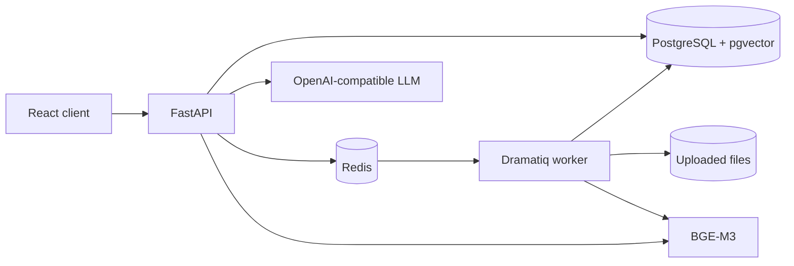

> **Project status:** Active MVP. Suitable for local evaluation and
> small-scale testing. Production-scale vector indexing, embedding-service
> separation, and load testing remain planned work.

# TechDoc AI

TechDoc AI is a multi-user technical-document question answering system built
with FastAPI, React, PostgreSQL, pgvector, BGE-M3, Redis, Dramatiq, and an
OpenAI-compatible LLM API.

## Architecture

The API stores users, documents, chunks, conversations, citations, and audit
events in PostgreSQL. Uploaded source files use a Docker volume. Redis persists
document jobs with AOF, and a dedicated single-process Dramatiq worker parses,
splits, and embeds documents. The API performs owner-scoped retrieval and sends
only retrieved context to the configured LLM.

The implemented MVP includes owner-scoped document and conversation access,
durable background indexing, cited answers, Redis-backed quotas, audit events,
Prometheus metrics, Sentry integration, and repeatable RAG evaluation fixtures.

## Data and confidentiality boundary

- Uploaded files remain in the configured upload volume. Parsed chunks, chat
  messages, citations, and audit events are stored in PostgreSQL.
- BGE-M3 embeddings run locally from the operator-provided model directory.
- Each chat request sends the question, a bounded recent-message history, and
  the retrieved document excerpts to `LLM_BASE_URL`. Do not point this setting
  at a third-party service unless its data-handling terms are acceptable for
  the documents being processed.
- Sentry is disabled unless `SENTRY_DSN` is configured outside the local
  environment. Operators should review telemetry policy before enabling it.
- Secrets, uploaded documents, databases, model weights, test reports, and
  local environment files are excluded from version control and Docker build
  contexts.

## Provenance and project-specific work

TechDoc AI is an independently maintained RAG application built on the
MIT-licensed
[Full Stack FastAPI Template](https://github.com/fastapi/full-stack-fastapi-template).

The upstream template provides the authentication, account-management,
full-stack, database, Docker, and base CI scaffold. TechDoc AI adds the
document-ingestion pipeline, BGE-M3 embeddings, pgvector retrieval,
background processing, cited chat, audit logging, observability, evaluation,
and the corresponding document and chat user interfaces.

The exact upstream baseline and inherited/project-specific boundaries are
documented in [NOTICE.md](NOTICE.md).

## Required local configuration

Merge the missing keys from .env.example into .env.local and set at least:

- SECRET_KEY
- FIRST_SUPERUSER and FIRST_SUPERUSER_PASSWORD
- POSTGRES_USER, POSTGRES_PASSWORD, and POSTGRES_DB
- BGE_MODEL_HOST_PATH
- LLM_API_KEY, LLM_BASE_URL, and LLM_MODEL

BGE_MODEL_HOST_PATH is a host path. EMBEDDING_MODEL_PATH is the container path
/models/bge-m3. Do not set EMBEDDING_MODEL_PATH to a Windows drive path.

The LLM API key remains local and must never be committed or printed in logs.
Keep an existing LLM_API_KEY unchanged when merging configuration.

## Start the stack

Use both files for Compose interpolation:

    docker compose --env-file .env.example --env-file .env.local up -d --build

Core services:

- db: PostgreSQL with pgvector
- redis: persistent document queue
- backend: FastAPI, one process
- worker: Dramatiq document worker, one process and one thread
- frontend: React application

Check health:

    docker compose --env-file .env.example --env-file .env.local ps
    curl http://localhost:8000/api/v1/utils/health/ready
    curl http://localhost:8000/metrics/

## Document processing

Uploads enter the queued state. The worker atomically claims a queued or failed
document, marks it processing, then parses, chunks, embeds, and commits a new
index. Failed tasks are retried with exponential backoff. Duplicate messages
exit when the document is already processing or indexed.

Redis AOF and app-upload-data must both be backed up in production.

## Tests

Backend:

    cd backend
    uv run ruff check app tests scripts
    uv run mypy app
    uv run ty check app
    uv run pytest

Frontend:

    cd frontend
    bun run build
    bunx playwright test

The real document-to-LLM Playwright workflow is opt-in because it consumes
model resources and LLM quota:

    $env:RUN_RAG_E2E="1"
    $env:PLAYWRIGHT_CHANNEL="chrome"
    bunx playwright test tests/techdoc-flow.spec.ts --project=chromium

## RAG evaluation

Upload the three files under backend/evals/documents using their original file
names. After indexing completes, run:

    cd backend
    uv run python scripts/evaluate_rag.py --user-email your-user@example.com

The report includes raw Recall@K, thresholded Recall@K, answer citation
precision, and per-question document scores. Use --min-score to test a
candidate threshold. Replace or extend backend/evals/rag_questions.json with
questions derived from the production knowledge base before tuning
RETRIEVAL_MIN_SCORE.

## Operations

The application exposes Prometheus metrics at /metrics/. Sentry captures model
and document-processing errors when SENTRY_DSN is configured. Request logs
include method, route template, status, duration, and request ID without
document text, questions, answers, passwords, or API keys.

Chat requests have per-minute and per-day Redis quotas. Uploads have a
per-minute limit. Administrators can query /api/v1/audit-logs/ for document and
conversation actions.

## Production checklist

- Provide secrets through the deployment platform rather than committed files.
- Mount a verified BGE-M3 directory read-only at /models/bge-m3.
- Persist and back up PostgreSQL, Redis, and app-upload-data.
- Configure SENTRY_DSN and Prometheus scraping.
- Run database migrations before starting API and worker services.
- Keep both API and document worker at one process while they load BGE-M3
  in-process. For horizontal scaling, move embeddings to a dedicated model
  service first.
- Run the backend suite, frontend build, Playwright workflow, and RAG evaluation
  before release.

## Current scale limits

- Vector search currently uses exact pgvector cosine ordering. Add and benchmark
  an HNSW or IVFFlat index before using a large chunk corpus.
- The API and worker each load BGE-M3 in-process. Separate embedding inference
  into a dedicated service before horizontal scaling.
- PDF parsing and embedding are bounded by upload size and job timeout, but have
  not yet been validated against adversarial PDFs or sustained concurrent load.
- Chat responses are synchronous and non-streaming; perceived latency is the
  sum of query embedding, vector search, and the configured LLM response time.

## License

TechDoc AI is distributed under the MIT License.

The project is derived from the MIT-licensed Full Stack FastAPI Template.
The upstream copyright and license are preserved in [LICENSE](LICENSE).
Project provenance and third-party attribution are documented in
[NOTICE.md](NOTICE.md) and [THIRD_PARTY_NOTICES.md](THIRD_PARTY_NOTICES.md).